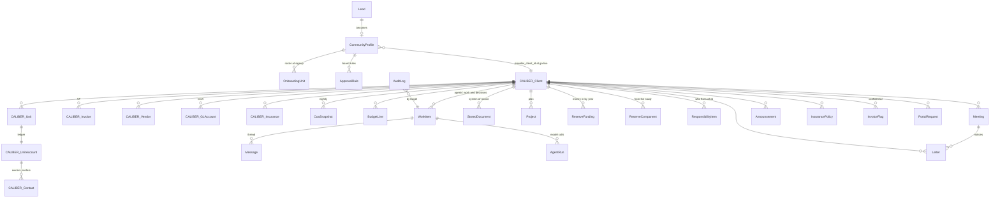

# 17 · Data model

Two layers. **Caliber (FrontSteps) is the ledger**: clients, units, owners, charges, payments, invoices, GL,
bank accounts. We read it nightly and on demand, write the few things its API allows, and never keep a
second copy of a balance. **hey's own database** holds what Caliber does not: the sales and onboarding
record, agents' work, decisions and rules, documents, the plan sheets, meetings, letters, insurance,
and every audit line. Keys that cross the line are Caliber ids stored as strings (`community_id` is the
Caliber `ClientID` once live, `unit_account_id` is `UnitAccountID`).

## Sales and onboarding (hey)

| Entity | What it is | Key fields | Caliber |
|---|---|---|---|
| **Lead** | A quote request, books review or import row | community_name, type, units, state, contact, email, status (new → contacted/replied/later → proposal → accepted → won/lost), score, replied_at, review (books-review memo) | none |
| **CommunityProfile** | The community from signup to go-live and after | slug, name, legal_name, kind, structure (standalone/master/sub), master_name, units + unit_kind, address, county, incorporation_state, ein_last4, fiscal_year_end, dues_amount + dues_frequency, plan + monthly_price, contact, board[] (name, title, email, signer), prior (setup, manager, bank), **agreement** (version, sha256, signed_by, title, signed_at, ip, user_agent, price), **bank** (accounts_opened, startup_amount, startup_check_mailed/received, final_transfer_mailed/received), checklist, status (signup → signed → onboarding → parallel → live), go_live_on, provider_client_id | `Client` (Name, Type, UnitCount, FiscalYearEnd, Master/sub via hierarchy), `ClientContactInfo` (address) |
| **OnboardingUnit** | Roster rows imported from CSV | unit_label, address, owner_name, email, phone, mailing_address, balance | becomes `Unit` + `UnitAccount` + `Contact` at go-live |
| **ApprovalRule** | Board rules: approvals per decision type | community_id, decision_type, approvals | none (Caliber's invoice approval count is set to match) |

## The ledger (Caliber, read through `AccountingProvider`)

| Dataclass | Caliber | Notes |
|---|---|---|
| Community | `Client` | id, name, kind, units, city, state, fiscal_year_end, dues_frequency |
| UnitAccount | `UnitAccount` + primary `Contact` | balance, autopay, next_due, status; owners see only their own |
| LedgerLine | `Transaction` / charges + applied payments | date, description, charge, payment, balance |
| Invoice | `Invoice` (+ `Payment` for paid_on, check_number) | status pending_board / approved / paid; approvals count |
| Delinquency | `/delinquencies` | stage, days late, last/next action; board only |
| Vendor | `Vendor` | W-9, COI, 1099 flags, remit |
| ServiceRequest / ArcRequest / Violation | maintenance, architectural, violations | write-through where the API allows |
| Document | `/documents` | board_only flag |
| FinancialSnapshot | derived from **CoaSnapshot** (nightly COA balances) + budgets + bank | cash basis only; no AR/AP/prepaid lines |
| Insurance | `Insurance` | mirrored by InsurancePolicy below; Caliber holds the vendor-side COIs |

## Books and reporting (hey)

| Entity | Key fields |
|---|---|
| **CoaSnapshot** | community_id, as_of, account number/name/type, balance, fy_balance. One row per account per night; the source for every package. |
| **BudgetLine** | community_id, year, gl_account, amount, approved_by. Caliber has no budgets. |
| **InvoiceFlag** | community_id, invoice_id, confidential, reason, set_by. Hides a bill from owners. |
| Financial package | not stored; rendered from snapshots, invoices, delinquencies and funding each month, then printed. Ten sections for the board, four for owners (doc 07). |

## Work and decisions (hey)

| Entity | Key fields |
|---|---|
| **WorkItem** | kind (email, sms, call, portal, invoice, decision, followup, reply, signup, reserve_study…), lane (cs, ar, ap, board, close, onboarding, sales), state (new → proposed → approved/done/rejected), community_id, unit_account_id, counterpart, subject, summary, evidence[], proposal{action, payload, preview, confidence, needs_review}, category (decision type), remote_ids{votes, lead_id, step…}, sla_due, shadow, priority |
| **Message** | work_item_id, direction, channel (email, sms, voice, portal, note), sender, recipient, subject, body, delivered, meta |
| **AgentRun** | work_item_id, lane, model, tokens, tool calls, duration, outcome |
| **AuditLog** | actor, action, target, detail. Every vote, send, setting, money step. |

Decisions are WorkItems with kind `decision`; votes live in `remote_ids.votes`; the quorum comes from
`ApprovalRule` for the community, else the defaults in `services/decisions.py`. Approved money decisions
become a `board_approved` item for the close lane: a person executes it at the bank.

## The board's system of record (hey)

| Entity | Key fields |
|---|---|
| **StoredDocument** | community_id, title, category (governing, rules, policy, contract, warranty, insurance, reserve_study, meetings, financial, vendor, arc, other), visibility (board/owners), file, vendor, effective_on, expires_on |
| **Project** | name, description, priority 1–3, status (planned, in_progress, under_review, scoping, completed), cost_low/high, year, fund (reserve/operating/special), updated_by |
| **ReserveFunding** | year, contribution, special_assessment, note. With Project it is the reserve plan sheet. |
| **ReserveComponent** | from the study: useful_life, remaining_life, replacement_cost, next_year; pulled into Projects |
| **ResponsibilityItem** | item, party (owner/association/shared), note (resolution, CC&R section) |
| **Meeting** | kind (board, annual, budget, special, executive), date, time, where, notice_days, notice_sent_at, notice_channels, agenda[], minutes, status |
| **Letter** | kind, unit_account_id, to_name, to_address, subject, body, status (queued/sent/simulated/failed), provider (lob/manual), provider_id, cost, certified, meeting_id, announcement_id |
| **Announcement** | title, body, channel (email, sms, portal, mail, mail_all), author |
| **BoardMember** | name, role (president, vice_president, treasurer, secretary, director), email, phone, unit, term_start, term_years, term_end, signer, contact_id (Caliber), password_hash, password_set_at, last_login_at, failed_logins, locked_until |
| **LoginCode** | member_id, code_hash, expires_at (10 min), used_at, attempts (max 5) |
| **CalendarItem** | title, kind (governance, accounting, meeting, insurance, maintenance, custom), repeats (annual, quarterly, monthly, once), month, day, year, lead_days, owner, source, steps[] |
| **CalendarDone** | item_id, period ("2026", "2026-Q3", "2026-11"), done_by, done_at |
| **InsurancePolicy** | kind (property, liability, do, fidelity, umbrella, workers_comp, cyber, flood, other), carrier, policy_number, coverage, deductible, premium, begins, expires, agent, document_id |
| **PortalRequest**, **ContactMessage** | owner portal forms and the public contact form before they become work |

## Rules that shape the model

- **Cash basis everywhere.** No receivable, payable or prepaid balances are stored; aged balances, AP
  and prepaid are memo reports computed from the ledger.
- **Money moves by a person.** There is no table of transfers because software never makes one; the
  decision, the audit line and the bank's own record are the trail.
- **Owners see their own account, never another's.** Delinquency, violations and other owners' balances
  are board-only reads; confidential invoices are hidden by InvoiceFlag.
- **One id per community.** Before go-live it is `new-<profile id>`; at go-live every row keyed on it
  is rekeyed to the Caliber ClientID.
- **Never the full EIN, SSN or bank account number** in hey's database. The bank and Caliber hold them.
